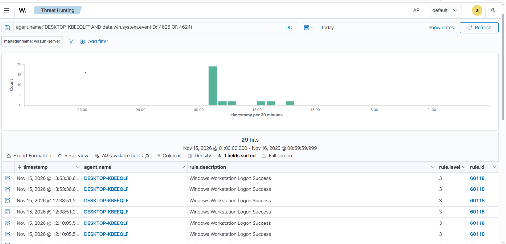

# SOC Incident Response & Authentication Log Analysis

## Executive Summary
This case study documents the end-to-end detection, forensic investigation, and SIEM correlation of a simulated brute-force authentication attack targeting a Windows endpoint (`DESKTOP-RCKI0QP`). Using **Windows Event Viewer** and **Wazuh SIEM**, this project demonstrates how a Security Operations Center (SOC) analyst isolates endpoint telemetry, normalizes cross-system timestamps, and distinguishes unauthorized brute-force attempts from successful account compromise.

---

## Incident Overview & Environment

| Attribute | Details |
| :--- | :--- |
| **Target Endpoint (VM)** | `DESKTOP-RCKI0QP` (Windows Security Event Log). |
| **SIEM Agent Hostname** | `DESKTOP-KBEEQLF` (Wazuh Agent). |
| **Attack Vector** | Credential Brute-Force / Password Guessing. |
| **Primary Event IDs** | `4625` (Audit Failure) & `4624` (Audit Success). |
| **Timezone Normalization** | Local Host (`WAT / UTC+1`) correlated with Wazuh SIEM (`UTC`). |

---

## Phase 1: Endpoint Forensic Analysis (Windows Event Viewer)

To investigate local host activity, the Windows Security Event Log was filtered for authentication telemetry (`Event ID 4625` and `4624`).

### 1. Brute-Force Failure Signatures (Event ID 4625)
Repeated authentication failures were captured, establishing a clear behavioral baseline of automated or manual credential guessing against the target host.
* **Event ID:** `4625` (Audit Failure).
* **Failure Status / Sub-Status:** `0xC000006D` / `0xC0000064` (Bad username or authentication information).
* **Caller Process:** `C:\Windows\System32\svchost.exe`.
* **Source Network Address:** `127.0.0.1`.

> .

### 2. Successful Authentication Compromise (Event ID 4624)
Immediately following the cluster of failed attempts, a successful logon event was recorded—marking the critical transition from active attack to unauthorized session establishment.
* **Event ID:** `4624` (Audit Success).
* **Compromised Account:** `oputaernestina321@gmail.com` (`MicrosoftAccount`).
* **Logon Process:** `C:\Windows\System32\lsass.exe` (Process ID: `0x2a4`).
* **Workstation Name:** `DESKTOP-RCKI0QP`.

> .

---

## Phase 2: Centralized SIEM Correlation & Threat Hunting (Wazuh)

To validate enterprise visibility, endpoint logs were ingested into Wazuh SIEM and queried within the Threat Hunting module.
* **Threat Hunting Query:**
  `agent.name:"DESKTOP-KBEEQLF" AND data.win.system.eventID:(4625 OR 4624)`.
* **SIEM Findings:** The Wazuh dashboard successfully correlated the local host telemetry with central alerts, visualizing alert volume spikes and indexing both `Logon Failure` and `Windows Workstation Logon Success` events under agent `DESKTOP-KBEEQLF`.

> .

---

## Key Takeaways & Remediation Recommendations
1. **End-to-End Log Correlation:** Verified that local Windows security audit channels map reliably to centralized SIEM rules, enabling rapid alert triage across distributed endpoints.
2. **Anomaly & Threshold Detection:** Demonstrated the importance of configuring SIEM correlation rules to trigger high-severity alerts when multiple `4625` failures are immediately followed by a `4624` success on the same host.
3. **Hardening & Containment Controls:**
   * Enforce strict **Account Lockout Policies** after repeated failed logon attempts.
   * Mandate **Multi-Factor Authentication (MFA)** across all user and administrative accounts.
   * Monitor `lsass.exe` and authentication subsystems for anomalous session token generation.
