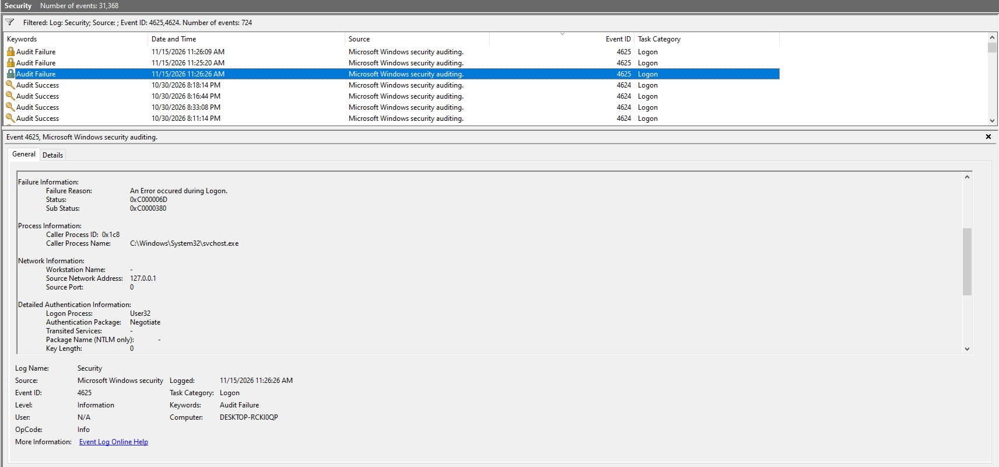

# SOC Incident Response & Authentication Log Analysis

## Executive Summary
This case study documents the end-to-end detection, forensic investigation, and SIEM correlation of a simulated brute-force authentication attack targeting a Windows endpoint (`DESKTOP-RCKI0QP`)[span_0](start_span)[span_0](end_span). Using **Windows Event Viewer** and **Wazuh SIEM**, this project demonstrates how a Security Operations Center (SOC) analyst isolates endpoint telemetry, normalizes cross-system timestamps, and distinguishes unauthorized brute-force attempts from successful account compromise[span_1](start_span)[span_1](end_span).

---

## Incident Overview & Environment

| Attribute | Details |
| :--- | :--- |
| **Target Endpoint (VM)** | `DESKTOP-RCKI0QP` (Windows Security Event Log)[span_2](start_span)[span_2](end_span) |
| **SIEM Agent Hostname** | `DESKTOP-KBEEQLF` (Wazuh Agent)[span_3](start_span)[span_3](end_span) |
| **Attack Vector** | Credential Brute-Force / Password Guessing[span_4](start_span)[span_4](end_span) |
| **Primary Event IDs** | `4625` (Audit Failure) & `4624` (Audit Success)[span_5](start_span)[span_5](end_span) |
| **Timezone Normalization** | Local Host (`WAT / UTC+1`) correlated with Wazuh SIEM (`UTC`)[span_6](start_span)[span_6](end_span) |

---

## Phase 1: Endpoint Forensic Analysis (Windows Event Viewer)

To investigate local host activity, the Windows Security Event Log was filtered for authentication telemetry (`Event ID 4625` and `4624`)[span_7](start_span)[span_7](end_span).

### 1. Brute-Force Failure Signatures (Event ID 4625)
Repeated authentication failures were captured, establishing a clear behavioral baseline of automated or manual credential guessing against the target host[span_8](start_span)[span_8](end_span).
* **Event ID:** `4625` (Audit Failure)[span_9](start_span)[span_9](end_span)
* **Failure Status / Sub-Status:** `0xC000006D` / `0xC0000064` (Bad username or authentication information)[span_10](start_span)[span_10](end_span)
* **Caller Process:** `C:\Windows\System32\svchost.exe`[span_11](start_span)[span_11](end_span)
* **Source Network Address:** `127.0.0.1`[span_12](start_span)[span_12](end_span)

> [span_13](start_span)[span_13](end_span)

### 2. Successful Authentication Compromise (Event ID 4624)
Immediately following the cluster of failed attempts, a successful logon event was recorded—marking the critical transition from active attack to unauthorized session establishment[span_14](start_span)[span_14](end_span).
* **Event ID:** `4624` (Audit Success)[span_15](start_span)[span_15](end_span)
* **Compromised Account:** `oputaernestina321@gmail.com` (`MicrosoftAccount`)[span_16](start_span)[span_16](end_span)
* **Logon Process:** `C:\Windows\System32\lsass.exe` (Process ID: `0x2a4`)[span_17](start_span)[span_17](end_span)
* **Workstation Name:** `DESKTOP-RCKI0QP`[span_18](start_span)[span_18](end_span)

> [span_19](start_span)[span_19](end_span)

---

## Phase 2: Centralized SIEM Correlation & Threat Hunting (Wazuh)

To validate enterprise visibility, endpoint logs were ingested into Wazuh SIEM and queried within the Threat Hunting module[span_20](start_span)[span_20](end_span).

* **Threat Hunting Query:**
  `agent.name:"DESKTOP-KBEEQLF" AND data.win.system.eventID:(4625 OR 4624)`[span_21](start_span)[span_21](end_span)
* **SIEM Findings:** The Wazuh dashboard successfully correlated the local host telemetry with central alerts, visualizing alert volume spikes and indexing both `Logon Failure` and `Windows Workstation Logon Success` events under agent `DESKTOP-KBEEQLF`[span_22](start_span)[span_22](end_span).

> [span_23](start_span)[span_23](end_span)

---

## Key Takeaways & Remediation Recommendations
1. **End-to-End Log Correlation:** Verified that local Windows security audit channels map reliably to centralized SIEM rules, enabling rapid alert triage across distributed endpoints[span_24](start_span)[span_24](end_span).
2. **Anomaly & Threshold Detection:** Demonstrated the importance of configuring SIEM correlation rules to trigger high-severity alerts when multiple `4625` failures are immediately followed by a `4624` success on the same host[span_25](start_span)[span_25](end_span).
3. **Hardening & Containment Controls:**
   * Enforce strict **Account Lockout Policies** after repeated failed logon attempts[span_26](start_span)[span_26](end_span).
   * Mandate **Multi-Factor Authentication (MFA)** across all user and administrative accounts[span_27](start_span)[span_27](end_span).
   * Monitor `lsass.exe` and authentication subsystems for anomalous session token generation[span_28](start_span)[span_28](end_span).
